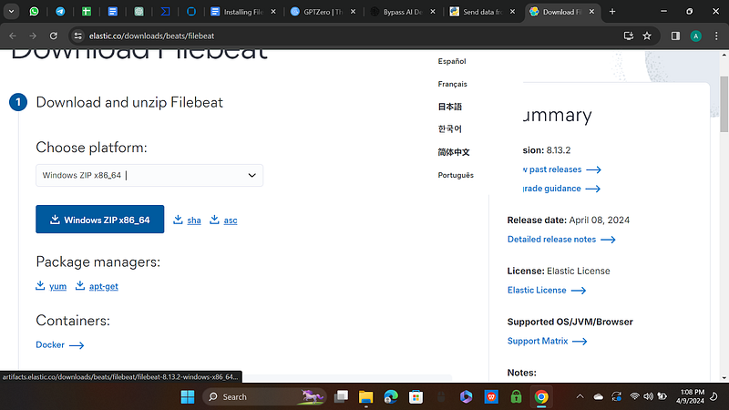
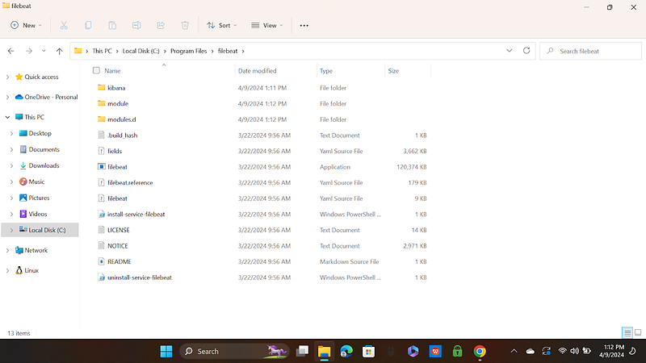
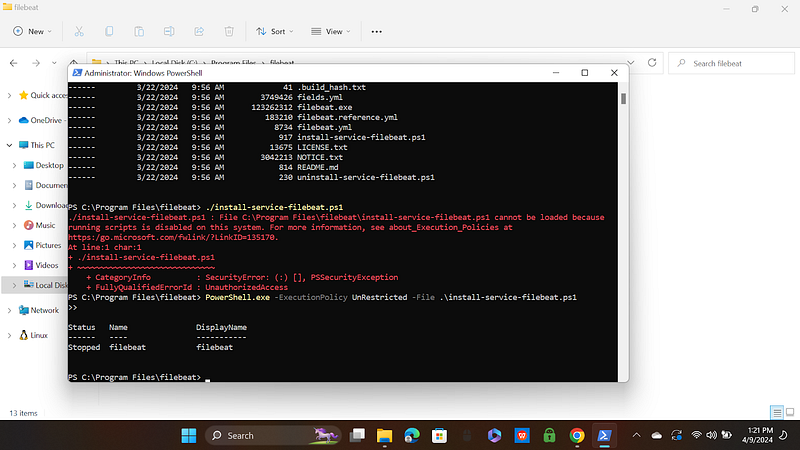
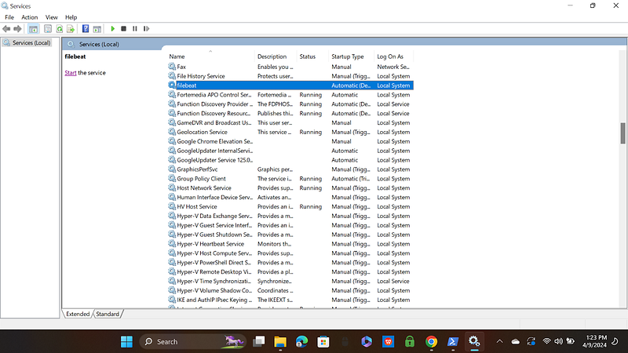
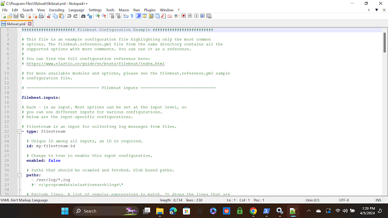
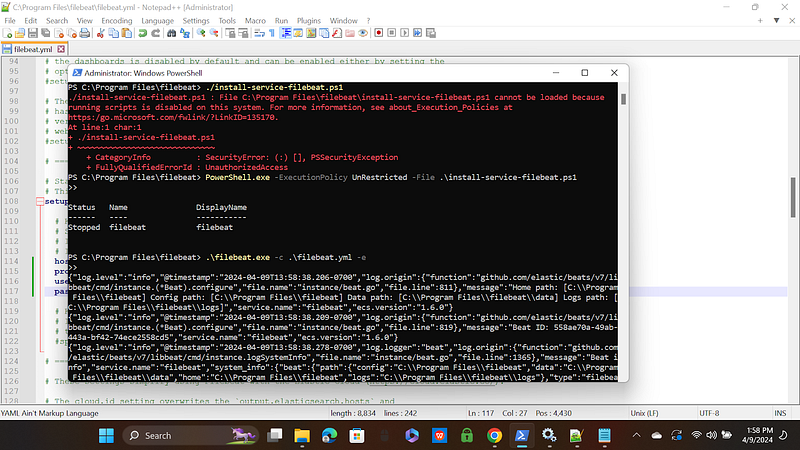
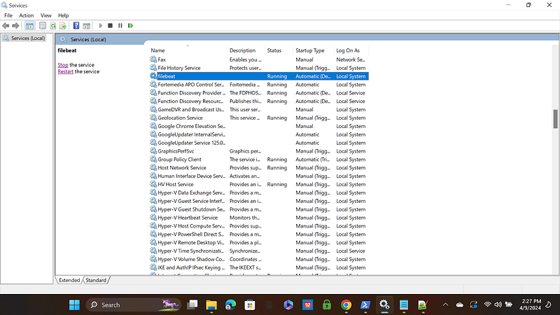
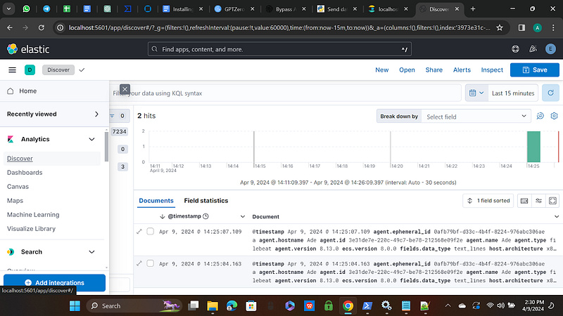

# How to Install and Configure Filebeat to Send Logs to Elasticsearch

📝 Originally published on [Medium](https://medium.com/@aabiodunadeleke/how-to-install-and-configure-filebeat-to-send-logs-to-elasticsearch-cf3904e6b9e3) · 2024-09-21

---

Filebeat is a lightweight shipper that tailors log data and forwards it to Logstash or Elasticsearch for indexing. In this guide, I will walk you through the process of installing Filebeat on a Windows environment and configuring it to send log data to Elasticsearch.

### Step 1: Download and Install Filebeat

#### 1.1. Download Filebeat

Begin by downloading the latest Filebeat version from the Elastic website [here](https://www.elastic.co/downloads/beats/filebeat). Make sure to choose the appropriate version for your system architecture (32-bit or 64-bit).



#### 1.2. Extract Filebeat

Once the download is complete, extract the contents of the zip archive into a folder, for example, `C:\Program Files\Filebeat`.



#### 1.3. Install Filebeat as a Windows Service

To install Filebeat as a service that will run in the background:

1. Open **PowerShell** as an administrator.
2. Navigate to the folder where you extracted Filebeat:   
   `Cd "C:\Program Files\Filebeat"`
3. Run the installation script:

```
install-service-filebeat.ps1
```

If script execution is blocked, use the command below to specify the execution policy.

```
PowerShell.exe -ExecutionPolicy UnRestricted -File .\install-service-filebeat.ps1
```



### 1.4 Verify Installation

Once the installation script finishes, Filebeat is installed as a Windows service. You can verify this by:

1. Opening the **Services** app (`services.msc`).
2. Searching for “Filebeat” in the list of services. From here, you can start, stop, or restart the service as needed.



### Step 2: Configuring Elasticsearch and Kibana Connectivity

### 2.1 Locate the Configuration File

Filebeat’s main configuration file, `filebeat.yml`, is located in the Filebeat folder at `C:\Program Files\Filebeat\filebeat.yml`. This file controls how Filebeat operates, including where it sends log data.

### 2.2 Open and Edit `filebeat.yml`

1. Open `filebeat.yml` in a text editor, such as **Notepad** or a more advanced editor like **Visual Studio Code**.



2. Find the section where Elasticsearch output is configured:

3. Replace `your-elasticsearch-host:9200` with the hostname and port of your Elasticsearch instance. If your cluster uses a non-default port or requires authentication, make sure to update the `username` and `password` fields as well.

```
output
.elasticsearch:
  hosts: [
"your-elasticsearch-host:9200"
]
  username: 
"elastic"
  password: 
"changeme"
```

### 2.3 Set Up the Filebeat Index Template and Kibana Dashboards

To enable Kibana dashboards for visualizing logs, you need to set up Filebeat’s index template and dashboards. Run the following command from the Filebeat directory:

```
.\filebeat.exe setup
```

### Step 3: Starting Filebeat

Now that Filebeat is configured, you can start the service:

1. Open a command prompt with administrative privileges.
2. Navigate to the Filebeat folder:

```
cd 'C:\Program Files\Filebeat'
```

3. Start Filebeat with the following command:

```
.\filebeat.exe -c .\filebeat.yml -e
```

The `-c` flag specifies the configuration file, and `-e` outputs log messages to the console. You can omit `-e` if you prefer not to see the log messages.



### Step 4: Viewing Logs in Kibana

To view the logs being sent by Filebeat to Elasticsearch, follow these steps:

1. Open **Kibana** in your web browser.
2. Navigate to the **Discover** tab, where you can view and analyze the logs indexed in Elasticsearch.



### Conclusion

You’ve successfully installed and configured Filebeat on a Windows machine to send logs to Elasticsearch! Now you can use Kibana to search, filter, and visualize log data for better monitoring and analysis of your system’s activity.
